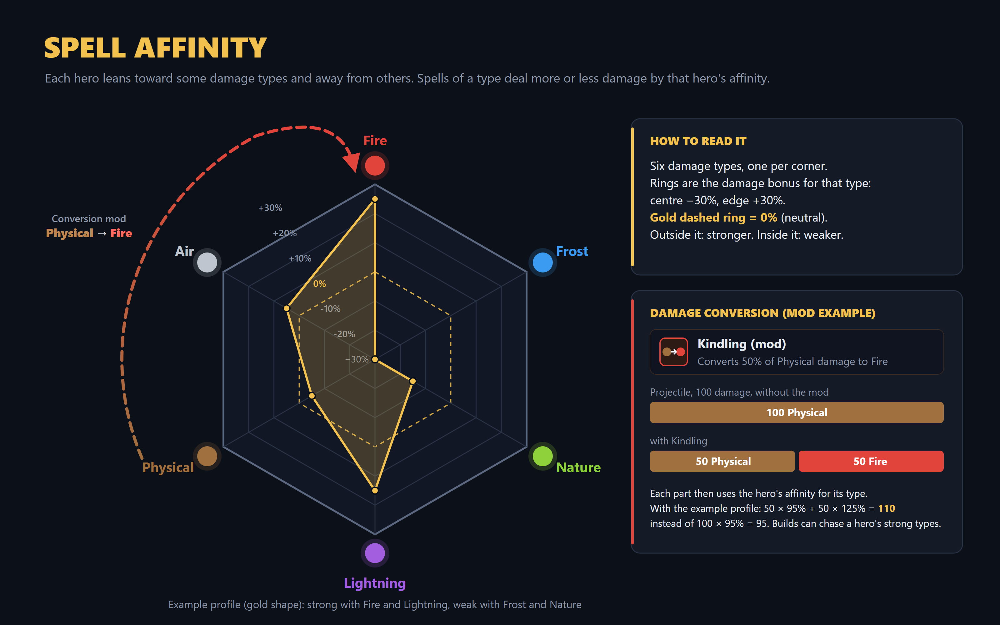
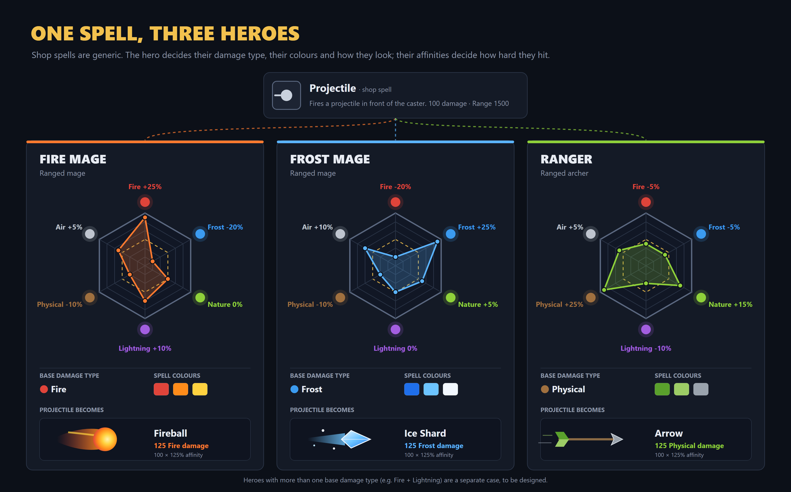

# Spell affinity

**Status:** idea, under discussion (Discord, spells-and-mods / game-mechanics).

## The problem

Spells are bought in the shop and any hero can use any of them. That keeps builds open, but it blurs hero identity: a frost mage throwing a Fireball looks wrong, and with several players using the same spell, everything looks alike.

Locking spells to hero types (e.g. melee heroes can't take ranged spells) was considered and set aside: it narrows choices too much.

## The idea

**1. The hero defines the damage type and colours of their spells.** Besides a passive and an ultimate, every hero comes with:
- a **base damage type** for all their spells, including basic Q/W/E;
- a **colour palette** for their spells.

Shop spells are generic and purely functional, e.g. *Projectile: fires a projectile in front of the caster. Range 1500.* On each hero the same spell takes their identity:

| Hero | Damage | Colours | Projectile becomes |
|---|---|---|---|
| Fire mage | Fire | red / orange / yellow | Fireball |
| Frost mage | Frost | blue / white | Ice shard |
| Ranger (archer) | Physical | green / grey | Arrow |

**2. Heroes lean toward some damage types (affinities).** Each hero has a bonus or penalty per damage type, e.g. *Fire +10%, Nature +5%, Frost −10%*. Heroes naturally lean toward certain playstyles but can still use any spell when they need it. This fits with the first idea; the two work together.

The six damage types, shown as a hexagon:

| Type | Colour |
|---|---|
| Fire | red |
| Frost | blue |
| Nature | green |
| Lightning | purple |
| Physical | brown |
| Air | grey |

**3. Conversion mods.** Mods can convert damage from one type to another (e.g. 50% Physical → Fire). Each part then uses the hero's affinity for its type, which opens up builds that chase a hero's strong types.

## Images





All numbers in the images are placeholders. They're generated by [make.py](make.py), which writes an HTML page per image; edit the profiles there to change them. To render the PNGs at 2× with headless Edge (run in this folder, Git Bash):

```bash
python make.py
EDGE="/c/Program Files (x86)/Microsoft/Edge/Application/msedge.exe"
for spec in "spell-affinity-system 1600,1000" "spell-affinity-heroes 1800,1120"; do
  set -- $spec
  "$EDGE" --headless=new --disable-gpu --hide-scrollbars --force-device-scale-factor=2 --window-size=$2 \
    --user-data-dir="$(cygpath -w "$PWD")\\.edge-profile" --screenshot="$(cygpath -w "$PWD")\\$1.png" \
    "file:///$(cygpath -m "$PWD")/$1.html"
done
```

## Open questions

- Heroes with more than one base damage type (e.g. Fire + Lightning).
- How the visual variants are made per spell (one look per damage type, or per hero).
- Affinity range: is ±30% right?
- Which damage types are reduced by armour and which by magic resist.
